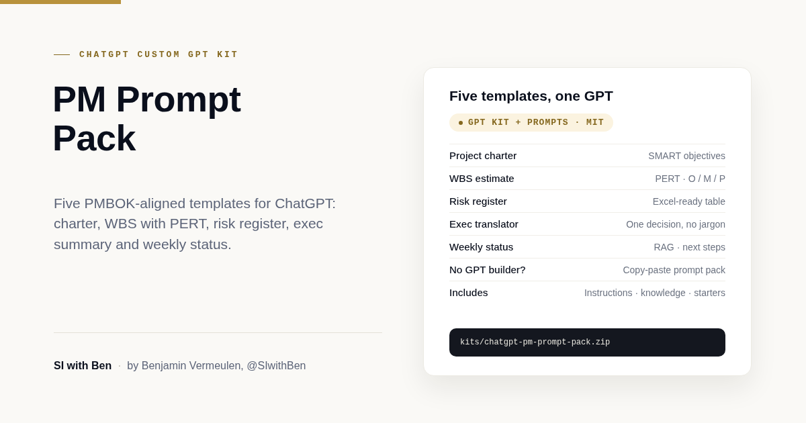

# PM Prompt Pack by SI with Ben (ChatGPT kit)

**Download:** [chatgpt-pm-prompt-pack.zip](../chatgpt-pm-prompt-pack.zip) has everything in this folder (GPT instructions, knowledge file, conversation starters, prompt pack and sample inputs).

I built this kit so you can turn my five project management prompts into your own custom GPT in about ten minutes. It drafts project charters, work breakdown structures with PERT estimates, risk registers, executive summaries and weekly RAG status reports, always in the same format, so your documents look consistent from one week to the next.

*By Benjamin Vermeulen, SI with Ben ([@SIwithBen](https://www.youtube.com/@SIwithBen)).*

## What it is

A ready-to-paste custom GPT configuration plus a plain prompt pack:

| File | What it's for |
|---|---|
| `gpt/name.txt` | GPT name |
| `gpt/description.txt` | GPT description |
| `gpt/conversation-starters.txt` | Four conversation starters, one per line |
| `gpt/instructions.md` | Behaviour rules for the GPT (under 8,000 characters) |
| `gpt/knowledge/pm-templates.md` | The five templates: inputs, method and exact output format |
| `prompt-pack.md` | Copy-paste versions of the five prompts, no GPT needed |
| `tests/sample-inputs.md` | Five fictional inputs to test the GPT |

The GPT works out which of the five templates you need, asks once for anything important that's missing, then drafts. It doesn't invent figures, dates, names or budgets; it marks gaps as "Not provided" or "TBC". Owners are roles, not people, and tables paste straight into Excel.

## Who it's for

Project managers, PMOs, team leads and anyone who writes charters, estimates, risk logs or status reports and wants a solid first draft in minutes. The structure follows PMBOK-style practice, so it suits most organisations.

## Requirements

- **To create the GPT:** a paid ChatGPT plan. Creating custom GPTs isn't available on the free plan.
- **To use the prompts without a GPT:** anyone, on any plan. Open `prompt-pack.md`, copy a prompt, fill in the placeholders.

## Create this GPT

1. Go to [chatgpt.com](https://chatgpt.com) and sign in.
2. Click **Explore GPTs**, then **Create**.
3. Switch to the **Configure** tab. I skip the Create (chat) tab because it rewrites your instructions.
4. **Name:** paste the contents of `gpt/name.txt`.
5. **Description:** paste the contents of `gpt/description.txt`.
6. **Instructions:** paste the full contents of `gpt/instructions.md`.
7. **Conversation starters:** add the four lines from `gpt/conversation-starters.txt`, one per box.
8. **Knowledge:** click **Upload files** and upload `gpt/knowledge/pm-templates.md`.
9. **Capabilities:**
   - Image generation: **off** (not needed).
   - Web search: optional. I leave it off so the GPT works only from what you give it.
   - Code Interpreter & Data Analysis: **on**, so it can export tables to CSV or Excel.
10. Click **Create** (or **Update**) and choose who can access it:
    - **Only me** for personal use, or
    - **Anyone with the link** to share it with your team.
11. Test it with the five scenarios in `tests/sample-inputs.md`. Check that each output follows the template headings, marks missing information instead of guessing, and ends with the review reminder.

If you change the instructions, keep them under 8,000 characters, which is the limit in the GPT builder. You can check with `wc -m gpt/instructions.md`.

## Note: custom GPTs are being retired

OpenAI has announced it is retiring custom GPTs in favour of ChatGPT plugins. Retirement for affected Enterprise workspaces is planned for 11 Dec 2026, and a migration flow is targeted from 17 Sep 2026. Dates can change, so check the current details on the [OpenAI help article](https://help.openai.com/en/articles/8554397).

That's one of the reasons I've kept `prompt-pack.md`: the same five prompts work as plain prompts in ChatGPT or any other assistant, so nothing here depends on the GPT builder.

## Always review

Every output is a draft. You are the final quality gate for accuracy, numbers and tone. Please also don't paste confidential client or personal data unless your workspace policy allows it.

## Featured in

- Video: [youtu.be/480NbXPA5q8](https://youtu.be/480NbXPA5q8)
- Video: [youtu.be/nnqyx-8pIVM](https://youtu.be/nnqyx-8pIVM)
- Substack: [my article on the five prompts](https://benjaminvermeulen.substack.com/p/5-chatgpt-prompts-that-save-project)
- Channel: [youtube.com/@SIwithBen](https://www.youtube.com/@SIwithBen)

## Licence

MIT. See [LICENSE](LICENSE). Use it, adapt it, share it with your team.
