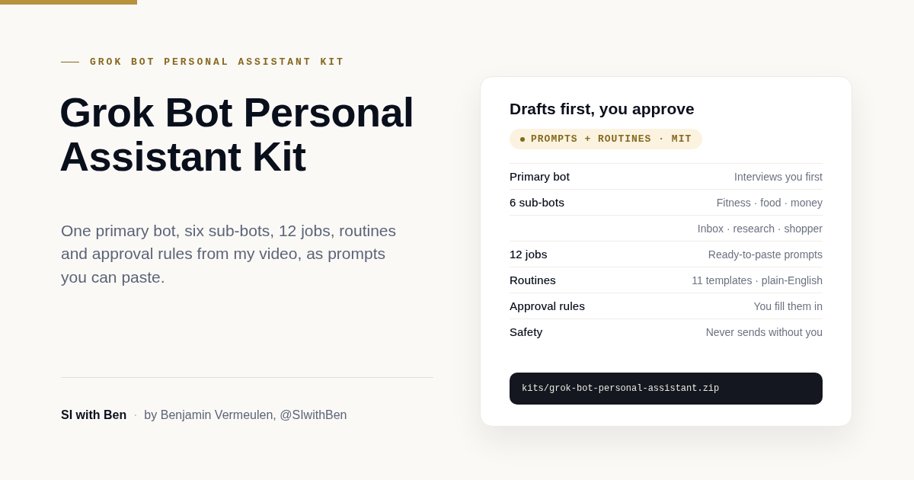

# Grok Bot personal assistant kit by SI with Ben

**Download:** [grok-bot-personal-assistant.zip](../grok-bot-personal-assistant.zip) has everything in this folder.

This is the setup from my video [How I Use GrokBot as My Personal Assistant](https://youtu.be/UBX3qXaFlgw), written down so you can build your own: one primary bot that you talk to, six sub-bots (fitness, food, money, inbox, research and shopping), the 12 jobs they do, the routines that run them in the background and the approval rules that keep you in charge. Everything is generic. It holds none of my details and works from your answers.

*By Benjamin Vermeulen, SI with Ben ([@SIwithBen](https://www.youtube.com/@SIwithBen)).*

**Version 1.0.0.** Treat it as a starting point and decide your own approval rules before you hand anything over.

## The video

[How I Use GrokBot as My Personal Assistant](https://youtu.be/UBX3qXaFlgw). Jump straight to each part:

| Part | Timestamp |
|---|---|
| My setup: one primary bot, six sub-bots | [00:26](https://youtu.be/UBX3qXaFlgw?t=26) |
| Connectors, own computer and routines | [03:09](https://youtu.be/UBX3qXaFlgw?t=189) |
| Routines that run in the background | [04:19](https://youtu.be/UBX3qXaFlgw?t=259) |
| Email drafts I approve before sending | [04:57](https://youtu.be/UBX3qXaFlgw?t=297) |
| Connectors in detail | [05:29](https://youtu.be/UBX3qXaFlgw?t=329) |
| How the handoff to sub-bots works | [06:36](https://youtu.be/UBX3qXaFlgw?t=396) |
| The 12 jobs in my setup | [07:46](https://youtu.be/UBX3qXaFlgw?t=466) |
| My weekly routine rhythm | [15:17](https://youtu.be/UBX3qXaFlgw?t=917) |
| Rules: what needs my approval | [15:30](https://youtu.be/UBX3qXaFlgw?t=930) |

## What's in the kit

| File | What it's for |
|---|---|
| [`prompts/00-primary-bot-setup.md`](prompts/00-primary-bot-setup.md) | A copy-paste prompt for the primary bot. It interviews you first, then sets up the sub-bots, jobs and routines only after you confirm. |
| [`prompts/sub-bots/`](prompts/sub-bots) | One prompt per sub-bot: fitness coach, food bot, money bot, inbox bot, research bot and personal shopper. |
| [`prompts/12-jobs.md`](prompts/12-jobs.md) | The 12 jobs as ready-to-paste prompts. |
| [`routines/routine-templates.md`](routines/routine-templates.md) | Eleven routine templates with plain-English schedules, cron-style notation and a blank weekly rhythm. |
| [`templates/approval-rules.md`](templates/approval-rules.md) | An approval-rules template you fill in, plus a rules block to paste into your primary bot. |
| [`checklists/connector-setup-checklist.md`](checklists/connector-setup-checklist.md) | A tick-box checklist for Gmail, Google Calendar, Google Drive, Notion, a budgeting app and Grok's own computer, with a test for each. |
| `tests/` | A script that checks the kit's structure and content (see "Checks" below). |

## Requirements

- **Grok Bot access.** In the video it comes with the unified X subscription (Premium, Super or Ultra). Check [x.ai/bot](https://x.ai/bot) for current availability.
- **Connectors, only the ones you need.** I use Gmail, Google Calendar, Google Drive and Notion. A budgeting app is optional. The checklist covers each one.
- Time: about an hour for the primary bot, the connectors and your first sub-bot; add the rest over a week or two.

## Setup, in order

1. **Decide your rules.** Fill in [`templates/approval-rules.md`](templates/approval-rules.md). It takes ten minutes and everything else builds on it.
2. **Connect your apps.** Work down [`checklists/connector-setup-checklist.md`](checklists/connector-setup-checklist.md). Test each connector before the next.
3. **Set up the primary bot.** Paste [`prompts/00-primary-bot-setup.md`](prompts/00-primary-bot-setup.md), answer the interview and read the one-page summary it gives you.
4. **Add sub-bots one at a time.** Paste the prompt from [`prompts/sub-bots/`](prompts/sub-bots). Start with the one you'd use most.
5. **Run each job by hand.** Use the prompts in [`prompts/12-jobs.md`](prompts/12-jobs.md). Check the output and that nothing was sent, bought or changed without your yes.
6. **Add routines.** Use [`routines/routine-templates.md`](routines/routine-templates.md), one at a time. Show the next run time, press **Test** and check the result. A test does real work, so use data you're comfortable with the bot reading.

## Staying in control

- **Drafts first.** Email replies and messages come to you as drafts. Leave drafts ON.
- **A yes before spending.** The bots fill baskets and compare prices. Buying needs your yes to that exact item and price.
- **Only low-risk work runs alone.** Summaries, research and reminders to you.
- **Keep sensitive access closed.** I keep my bank accounts disconnected and pull spending through a separate budgeting app. You decide yours.
- **Nothing private in the kit.** Put your details in your own chat, not in files you share.
- **Check the results.** The bots can get things wrong. Read what they produce, especially prices, dates and money figures.

## Related kits

- [grok-bot-starter-skills](../grok-bot-starter-skills): tested, approval-first skills for inbox clean-up, follow-ups, notes to tasks, red-team review and a weekly status report. The inbox bot and the meeting-notes job in this kit can use them.
- [notion-action-list](../notion-action-list): a ready-to-import Notion task database.

## Checks

`tests/test_kit.py` checks that the kit has the six sub-bot prompts, all 12 jobs, the routine templates, the approval-rules template and the connector checklist, that every prompt states an approval boundary, that no email address, phone number or key has slipped in, and that the public text follows the SI branding. Run it with `python3 -m unittest discover -s kits/grok-bot-personal-assistant/tests -v`. `tests/evidence/` records how I dry-ran the prompts.

## Featured in

- Video: [How I Use GrokBot as My Personal Assistant](https://youtu.be/UBX3qXaFlgw)
- Grok Bot docs: [Skills, routines and automations](https://docs.x.ai/grok-bot/skills-routines-and-automations)
- Channel: [youtube.com/@SIwithBen](https://www.youtube.com/@SIwithBen)

## Licence

MIT. See [LICENSE](LICENSE). Use it, adapt it, share it with your team.
