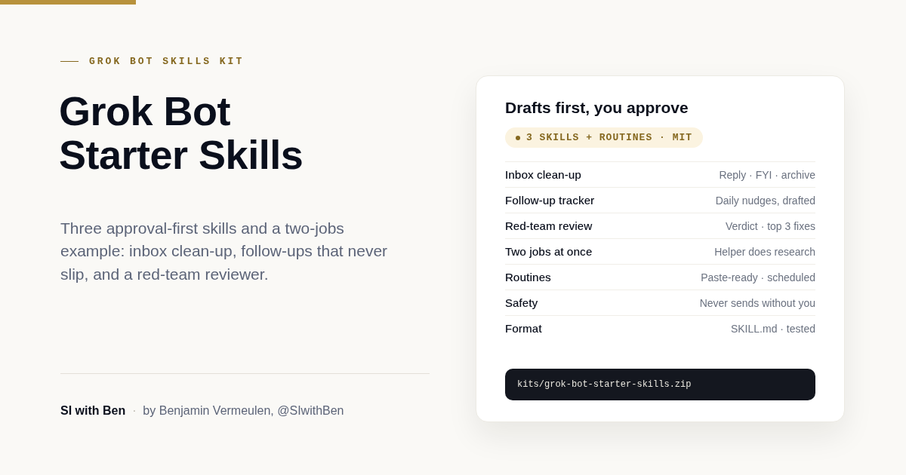

# Grok Bot starter skills by SI with Ben

**Download:** [grok-bot-starter-skills.zip](../grok-bot-starter-skills.zip) has everything in this folder (three skills, the two-jobs example and sample test data).

I put this kit together so you can set up the Grok Bot examples from my video in about fifteen minutes. You get three ready-to-save skills: one that cleans up your inbox, one that makes sure you never miss a follow-up, and one that red-teams your ideas before you commit to them. Each skill drafts and proposes; you stay in control of anything that gets sent, moved or deleted.

*By Benjamin Vermeulen, SI with Ben ([@SIwithBen](https://www.youtube.com/@SIwithBen)).*

## The video

[Practical Grok Bot Examples](https://youtu.be/O5bHcw_EHQs). Jump straight to each part:

| Part | Timestamp |
|---|---|
| Inbox clean-up | [02:42](https://youtu.be/O5bHcw_EHQs?t=162) |
| Inbox clean-up results | [13:24](https://youtu.be/O5bHcw_EHQs?t=804) |
| Follow-ups | [04:55](https://youtu.be/O5bHcw_EHQs?t=295) |
| Two jobs at once | [05:14](https://youtu.be/O5bHcw_EHQs?t=314) |
| Staying in control | [05:59](https://youtu.be/O5bHcw_EHQs?t=359) |
| Red team | [07:20](https://youtu.be/O5bHcw_EHQs?t=440) |

## What's in the kit

| File | What it's for |
|---|---|
| `skills/inbox-cleanup/SKILL.md` | Sorts your inbox into Needs reply, FYI and Archive or unsubscribe candidates, drafts replies, flags sensitive emails. Includes a paste-ready routine. |
| `skills/follow-up-tracker/SKILL.md` | Daily check of who you're waiting on, who's waiting on you and what's due in the next 2 days. Drafts polite nudges. Includes a paste-ready routine. |
| `skills/red-team-review/SKILL.md` | A tough but fair review of an idea, plan, build or document, with a verdict and top 3 fixes. Never edits your work. |
| `examples/two-jobs-at-once.md` | A paste-ready prompt for running background research while your Bot drafts a meeting agenda with you. |
| `tests/sample-data/` | Fictional inbox, sent emails, tasks and an idea, so you can try the skills without touching real data. |

Each skill follows the same pattern: when to use it, what access it needs, the sequence of work, how to check the result, what to return, and what needs your approval.

## Requirements

- **Grok Bot access.** See [x.ai/bot](https://x.ai/bot) for current availability.
- **Connectors, only the ones you need:**
  - Inbox clean-up: your email (for example Gmail).
  - Follow-up tracker: your email, plus a task tool (for example Notion) if you want tasks included.
  - Two jobs at once: your calendar, plus a task tool if you want tasks in the agenda.
  - Red team review: nothing. Paste the work into the chat.

## Setup

### 1. Add each skill

1. Open a chat with your Bot.
2. Paste the full contents of a `SKILL.md` file and say: **"Save this as a private skill called inbox-cleanup."** (Use `follow-up-tracker` or `red-team-review` for the others.)
3. Type `/` in the desktop composer and check the skill appears in the menu. Private skills are one library shared by all your Bots, so you only add each one once.
4. If it isn't in the `/` menu, go to **Marketplace > Your plugins > Manage plugins and skills > Private skills** and check it's there.

Quick reminder: `/` is for skills, `@` is for Bots, groups, routines and connectors.

### 2. Test with a one-off run first

Before you schedule anything, run each skill once by hand. For example: "Run /inbox-cleanup on my inbox for the last 24 hours." Check the output format, that drafts are labelled "DRAFT, not sent", and that nothing was sent or moved.

To try it with no real data at all, paste a file from `tests/sample-data/` into the chat and ask the Bot to run the skill on that text instead.

### 3. Create the routine

1. Open a chat with the Bot that should own the routine.
2. Paste the prompt from the **ROUTINE** section at the bottom of the skill (inbox clean-up suggests weekdays at 07:30, follow-up tracker suggests weekdays at 16:00). Change the time zone to yours.
3. Before you accept, confirm the owning Bot, the schedule and time zone, the input source, the expected result, the approval boundary, and what happens when a source is missing.
4. The Bot shows the next run time. Background routines run even with your laptop closed.
5. Press **Test run**. A test run does real work, so it will read real email and create real drafts.

### 4. Check the Routines panel

Open the Bot, then **View conversation details > Routines**. From there you can pause, test, edit, view history or delete a routine. Deleting has no undo, so pause instead if you're unsure.

Limits worth knowing: up to 50 routines per Bot, and schedules need to be at least five minutes apart.

## Staying in control

These are the rules I follow, and the skills are written to match them:

- **Leave drafts ON.** Email and Slack messages arrive as editable draft cards with Send or Discard. There's a per-Bot "Disable drafts" option; please don't use it with these skills.
- **Approve every send.** Nothing goes out, gets archived, deleted, moved or unsubscribed unless you say so in the conversation.
- **Read-only first.** Start with read access and drafts. Widen access only once you trust the results.
- **Connect only what you need.** Each skill lists what it needs. Don't connect extra tools "just in case".
- **Check sensitive items yourself.** The inbox skill flags legal, HR, finance and security alert emails instead of drafting replies. Those are yours to handle.

## Featured in

- Video: [Practical Grok Bot Examples](https://youtu.be/O5bHcw_EHQs)
- Grok Bot docs: [Skills, routines and automations](https://docs.x.ai/grok-bot/skills-routines-and-automations)
- Channel: [youtube.com/@SIwithBen](https://www.youtube.com/@SIwithBen)

## Licence

MIT. See [LICENSE](LICENSE). Use it, adapt it, share it with your team.
